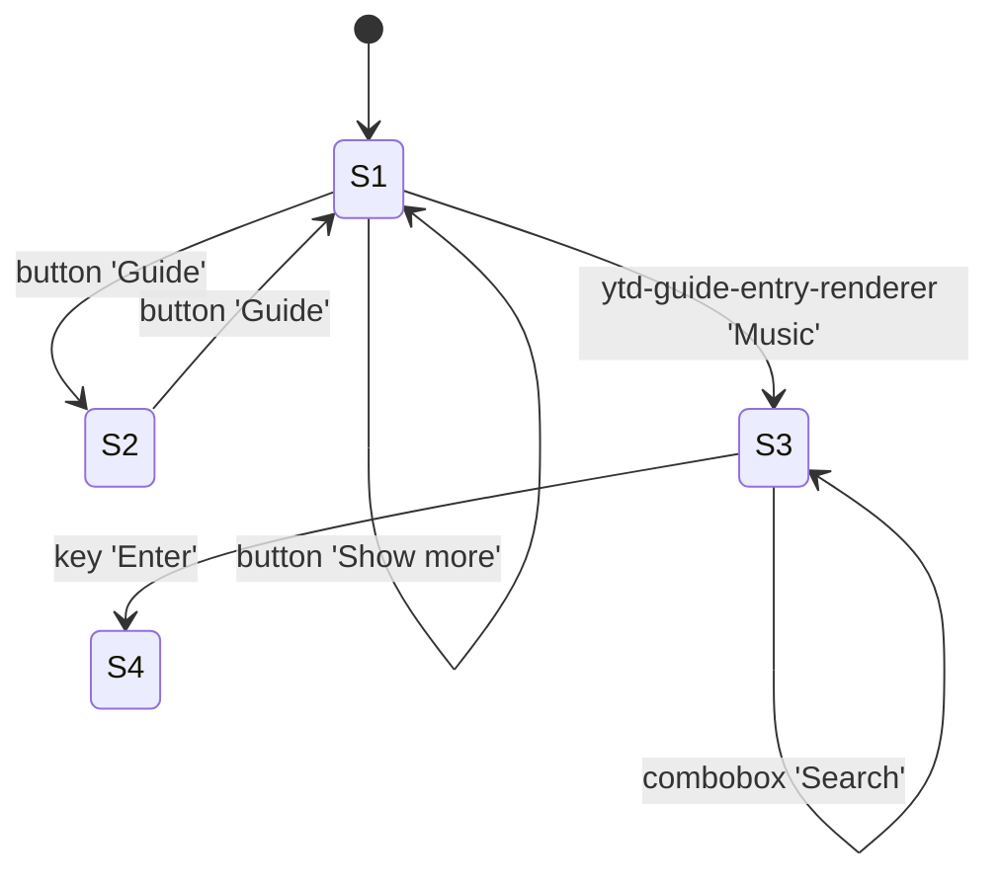

# Feature spec — YouTube guide sidebar

**YouTube guide sidebar** — reimplemented from an observed run. 5 surface component(s) (main content, sidebar / navigation, tab strip, search). 6 observed interaction(s) across 3 state(s). 5 API endpoint(s) with 14 observed payload shape(s).

> Provenance: launch-web capture of `https://www.youtube.com/` at 2026-10-20T19:49:42Z, debuggee Chrome/155.0.8059.85. Every row below is `observed` unless tagged `inferred`; unknowns are listed at the end.

## 1. Surfaces
| id | component | kind | role | layouts (px) | controls |
|----|-----------|------|------|--------------|----------|
| C1 | main content | main content | `main` | 1200x176, 1368x176, 1200x3984 | 84 |
| C2 | sidebar / navigation | sidebar / navigation | `navigation` | 240x964, 72x844 | 38 |
| C3 | tab strip | tab strip | `tablist` | 1152x48, 120x48 | 3 |
| C4 | search | search | `search` | 640x40 | 2 |
| C5 | app chrome | app chrome | `chrome` | ? | 7 |

## 2. Static evidence (bundle / binary)
_No static lane evidence for this target._

## 3. Interaction contract
| # | control | effect | state | calls |
|---|---------|--------|-------|-------|
| T1 | button 'Guide' | hides 20 control(s); the navigation surface shrinks | S1 → S2 | — |
| T2 | button 'Guide' | reveals 20 control(s) in navigation | S2 → S1 | — |
| T3 | button 'Show more' | swaps the panel surface (9 shown, 2 hidden) | S1 → S1 | — |
| T4 | ytd-guide-entry-renderer 'Music' | navigates to `/channel/UC-9-kyTW8ZkZNDHQJ6FgpwQ` → `POST /youtubei/v1/browse` (200), +1 more | S1 → S3 | `POST /youtubei/v1/browse` `POST /youtubei/v1/player` |
| T5 | combobox 'Search' | accepts typed input and requests suggestions → `GET /complete/search` (200), +1 more | S3 → S3 | `GET /complete/search` `GET /complete/search` |
| T6 | key 'Enter' | navigates to `/results?search_query=reverse+engineer+app` → `GET /complete/search` (200) | S3 → S4 | `GET /complete/search` |

## 4. State model
| state | route | regions visible | dialogs | controls |
|-------|-------|-----------------|---------|----------|
| S1 | `/` | navigation, main, search | 0 | 51 |
| S2 | `/` | main, navigation, search | 0 | 12 |
| S3 | `/channel/UC-9-kyTW8ZkZNDHQJ6FgpwQ` | main, navigation, tablist, search, tablist | 0 | 220 |
| S4 | `/results` | main, navigation, tablist, search, tablist | 0 | 220 |

## 5. Data model
### Guide

| field | type |
|-------|------|
| `responseContext` | object |
| `responseContext.serviceTrackingParams` | array<object> |
| `responseContext.serviceTrackingParams[].service` | string |
| `responseContext.serviceTrackingParams[].params` | array<object> |
| `responseContext.serviceTrackingParams[].params[].key` | ... |
| `responseContext.serviceTrackingParams[].params[].value` | ... |
| `responseContext.maxAgeSeconds` | number |
| `responseContext.mainAppWebResponseContext` | object |
| `responseContext.mainAppWebResponseContext.loggedOut` | bool |
| `responseContext.mainAppWebResponseContext.trackingParam` | string |
| `responseContext.responseId` | string |
| `responseContext.webResponseContextExtensionData` | object |
| `responseContext.webResponseContextExtensionData.webResponseContextPreloadData` | object |
| `responseContext.webResponseContextExtensionData.webResponseContextPreloadData.preloadMessageNames` | array<string> |
| `responseContext.webResponseContextExtensionData.hasDecorated` | bool |
| `items` | array<object> |
| `items[].guideSectionRenderer` | object |
| `items[].guideSectionRenderer.items` | array<object> |
| `items[].guideSectionRenderer.items[].guideEntryRenderer` | ... |
| `items[].guideSectionRenderer.trackingParams` | string |

_Sources: POST /youtubei/v1/guide_

### Feedback

| field | type |
|-------|------|
| `responseContext` | object |
| `responseContext.serviceTrackingParams` | array<object> |
| `responseContext.serviceTrackingParams[].service` | string |
| `responseContext.serviceTrackingParams[].params` | array<object> |
| `responseContext.serviceTrackingParams[].params[].key` | ... |
| `responseContext.serviceTrackingParams[].params[].value` | ... |
| `responseContext.mainAppWebResponseContext` | object |
| `responseContext.mainAppWebResponseContext.loggedOut` | bool |
| `responseContext.mainAppWebResponseContext.trackingParam` | string |
| `responseContext.responseId` | string |
| `responseContext.webResponseContextExtensionData` | object |
| `responseContext.webResponseContextExtensionData.hasDecorated` | bool |
| `feedbackResponses` | array<object> |
| `feedbackResponses[].isProcessed` | bool |

_Sources: POST /youtubei/v1/feedback_

### GenerateIT

| field | type |
|-------|------|
| `value` | array<string> |

_Sources: POST /api/jnn/v1/GenerateIT_

### LogEvent

| field | type |
|-------|------|
| `responseContext` | object |

_Sources: POST /youtubei/v1/log_event_

### Player

| field | type |
|-------|------|
| `responseContext` | object |
| `responseContext.serviceTrackingParams` | array<object> |
| `responseContext.serviceTrackingParams[].service` | string |
| `responseContext.serviceTrackingParams[].params` | array<object> |
| `responseContext.serviceTrackingParams[].params[].key` | ... |
| `responseContext.serviceTrackingParams[].params[].value` | ... |
| `responseContext.maxAgeSeconds` | number |
| `responseContext.mainAppWebResponseContext` | object |
| `responseContext.mainAppWebResponseContext.loggedOut` | bool |
| `responseContext.mainAppWebResponseContext.trackingParam` | string |
| `responseContext.responseId` | string |
| `responseContext.webResponseContextExtensionData` | object |
| `responseContext.webResponseContextExtensionData.webResponseContextPreloadData` | object |
| `responseContext.webResponseContextExtensionData.webResponseContextPreloadData.preloadMessageNames` | array<string> |
| `responseContext.webResponseContextExtensionData.hasDecorated` | bool |
| `playabilityStatus` | object |
| `playabilityStatus.status` | string |
| `playabilityStatus.reason` | string |
| `playabilityStatus.errorScreen` | object |
| `playabilityStatus.errorScreen.playerInterstitialRenderer` | object |

_Sources: POST /youtubei/v1/player_

### Client-side state

| storage | shape |
|---------|-------|
| `local storage['V73c188c6||::yt-player::yt-player-lv']` | data: string, creation: number |
| `local storage['ytidb::LAST_RESULT_ENTRY_KEY']` | data: object, data.hasSucceededOnce: boolean, expiration: number, creation: number |
| `session storage['yt-remote-cast-available']` | data: string, creation: number |
| `session storage['yt-remote-cast-installed']` | data: string, creation: number |
| `local storage['yt-remote-connected-devices']` | data: string, expiration: number, creation: number |
| `local storage['yt-remote-device-id']` | data: string, expiration: number, creation: number |
| `session storage['yt-remote-fast-check-period']` | data: string, creation: number |
| `session storage['yt-remote-session-app']` | data: string, creation: number |
| `session storage['yt-remote-session-name']` | data: string, creation: number |

## 6. API surface
| method | path | status | calls | response shape |
|--------|------|--------|-------|----------------|
| POST | `/api/jnn/v1/GenerateIT` | 200 | 1 | [string] |
| POST | `/youtubei/v1/browse` | 200 | 1 | — |
| POST | `/youtubei/v1/feedback` | 200 | 1 | { responseContext: { serviceTrackingParams: [{ service: string, params: [{ key: ..., value: ... }] }], mainAppWebResponseContext: { loggedOut: bool, trackingParam: string }, responseId: string, webResponseContextExtensionData: { hasDecorate … |
| POST | `/youtubei/v1/guide` | 200 | 1 | { responseContext: { serviceTrackingParams: [{ service: string, params: [{ key: ..., value: ... }] }], maxAgeSeconds: number, mainAppWebResponseContext: { loggedOut: bool, trackingParam: string }, responseId: string, webResponseContextExten … |
| POST | `/youtubei/v1/player` | 200 | 1 | { responseContext: { serviceTrackingParams: [{ service: string, params: [{ key: ..., value: ... }] }], maxAgeSeconds: number, mainAppWebResponseContext: { loggedOut: bool, trackingParam: string }, responseId: string, webResponseContextExten … |

_146 call(s) excluded from this contract as non-API traffic — document loads, static assets, telemetry, advertising or media delivery._

## 7. Build plan
### B1 — Build the main content component
_kind: ui · evidence: screen snapshots + region inventory_
- [ ] renders as a `main` region (main content)
- [ ] observed layouts: 1200x176, 1368x176, 1200x3984 px in a 1440x900 viewport
- [ ] exposes 84 interactive control(s): button 'A$AP ROCKY - SHROOM CLOUDS (Official Video)', button 'Collaboration channels', button 'Fontaines D.C. - Japan (Official Music Video)', button 'Go to channel Ashe', button 'Go to channel Mollie Elizabeth', button 'Go to channel Rachel Chinouriri'

### B2 — Build the sidebar / navigation component
_kind: ui · evidence: screen snapshots + region inventory_
- [ ] renders as a `navigation` region (sidebar / navigation)
- [ ] observed layouts: 240x964, 72x844 px in a 1440x900 viewport
- [ ] exposes 38 interactive control(s): button 'Show less', button 'Show more', link 'About', link 'Advertise', link 'Contact us', link 'Copyright'

### B3 — Build the tab strip component
_kind: ui · evidence: screen snapshots + region inventory_
- [ ] renders as a `tablist` region (tab strip)
- [ ] observed layouts: 1152x48, 120x48 px in a 1440x900 viewport
- [ ] exposes 3 interactive control(s): tab 'Home', tab 'Posts', tablist 'Home Posts'

### B4 — Build the search component
_kind: ui · evidence: screen snapshots + region inventory_
- [ ] renders as a `search` region (search)
- [ ] observed layouts: 640x40 px in a 1440x900 viewport
- [ ] exposes 2 interactive control(s): button 'Clear search query', button 'Search'

### B5 — Build the app chrome component
_kind: ui · evidence: screen snapshots + region inventory_
- [ ] renders as a `chrome` region (app chrome)
- [ ] exposes 7 interactive control(s): button 'Guide', button 'Search with your voice', button 'Settings', button 'Skip navigation', combobox 'Search', link 'Sign in'

### B6 — Implement button interactions (5 observed)
_kind: interaction · evidence: transition records T1, T2, T3, T4, T6_
- [ ] button 'Guide' → hides 20 control(s); the navigation surface shrinks
- [ ] button 'Guide' → reveals 20 control(s) in navigation
- [ ] button 'Show more' → swaps the panel surface (9 shown, 2 hidden)
- [ ] ytd-guide-entry-renderer 'Music' → navigates to `/channel/UC-9-kyTW8ZkZNDHQJ6FgpwQ` → `POST /youtubei/v1/browse` (200), +1 more
- [ ] key 'Enter' → navigates to `/results?search_query=reverse+engineer+app` → `GET /complete/search` (200)

### B7 — Implement form field interactions (1 observed)
_kind: interaction · evidence: transition records T5_
- [ ] combobox 'Search' → accepts typed input and requests suggestions → `GET /complete/search` (200), +1 more

### B8 — Implement `POST /api/jnn/v1/GenerateIT`
_kind: api · evidence: observed 1 call(s); response body artifact_
- [ ] `POST /api/jnn/v1/GenerateIT` returns 200
- [ ] response shape: [string]

### B9 — Implement `POST /youtubei/v1/browse`
_kind: api · evidence: observed 1 call(s); response body artifact_
- [ ] `POST /youtubei/v1/browse` returns 200

### B10 — Implement `POST /youtubei/v1/feedback`
_kind: api · evidence: observed 1 call(s); response body artifact_
- [ ] `POST /youtubei/v1/feedback` returns 200
- [ ] response shape: { responseContext: { serviceTrackingParams: [{ service: string, params: [{ key: ..., value: ... }] }], mainAppWebResponseContext: { loggedOut: bool, trackingParam: string }, responseId: string, webResponseContextExtensionData: { hasDecorated: bool } }, feedbackResponses: [{ isProcessed: bool }] }

### B11 — Implement `POST /youtubei/v1/guide`
_kind: api · evidence: observed 1 call(s); response body artifact_
- [ ] `POST /youtubei/v1/guide` returns 200
- [ ] response shape: { responseContext: { serviceTrackingParams: [{ service: string, params: [{ key: ..., value: ... }] }], maxAgeSeconds: number, mainAppWebResponseContext: { loggedOut: bool, trackingParam: string }, responseId: string, webResponseContextExtensionData: { webResponseContextPreloadData: { preloadMessageNames: [string] }, hasDecorated: bool } }, items: [{ guideSectionRenderer: { items: [{ guideEntryRenderer: ... }], trackingParams: string } }], trackingParams: string }

### B12 — Implement `POST /youtubei/v1/player`
_kind: api · evidence: observed 1 call(s); response body artifact_
- [ ] `POST /youtubei/v1/player` returns 200
- [ ] response shape: { responseContext: { serviceTrackingParams: [{ service: string, params: [{ key: ..., value: ... }] }], maxAgeSeconds: number, mainAppWebResponseContext: { loggedOut: bool, trackingParam: string }, responseId: string, webResponseContextExtensionData: { webResponseContextPreloadData: { preloadMessageNames: [string] }, hasDecorated: bool } }, playabilityStatus: { status: string, reason: string, errorScreen: { playerInterstitialRenderer: { content: { interstitialViewModel: { title: ..., description: ..., loggingDirectives: ... } }, stateEntityStoreKey: string } }, contextParams: string }, videoDetails: { videoId: string, title: string, lengthSeconds: string, keywords: [string], channelId: string, isOwnerViewing: bool, shortDescription: string, isCrawlable: bool, thumbnail: { thumbnails: [{ url: string, width: number, height: number }] }, allowRatings: bool, viewCount: string, author: string }, microformat: { playerMicroformatRenderer: { thumbnail: { thumbnails: [{ url: ..., width: ..., height: ... }] }, embed: { iframeUrl: string, width: number, height: number }, title: { simpleText: string }, description: { simpleText: string }, lengthSeconds: string, ownerProfileUrl: string, externalChannelId: string, isFamilySafe: bool, availableCountries: [string], isUnlisted: bool, hasYpcMetadata: bool, viewCount: string } }, trackingParams: string, adBreakHeartbeatParams: string, frameworkUpdates: { entityBatchUpdate: { mutations: [{ entityKey: string, type: string, payload: { offlineabilityEntity: ... } }], timestamp: { seconds: string, nanos: number } } } }

### B13 — Persist client state
_kind: data · evidence: storage shape probe before/after the run_
- [ ] writes localStorage['V73c188c6||::yt-player::yt-player-lv'], sessionStorage['yt-remote-cast-available'], sessionStorage['yt-remote-cast-installed'], localStorage['yt-remote-connected-devices'], localStorage['yt-remote-device-id'], sessionStorage['yt-remote-fast-check-period'], sessionStorage['yt-remote-session-app'], sessionStorage['yt-remote-session-name'], localStorage['ytidb::LAST_RESULT_ENTRY_KEY']

## 8. Parity checklist
Ship only when every line holds:

- [ ] Clicking **button 'Guide'** hides 20 control(s); the navigation surface shrinks (state S1 → S2).
- [ ] Clicking **button 'Guide'** reveals 20 control(s) in navigation (state S2 → S1).
- [ ] Clicking **button 'Show more'** swaps the panel surface (9 shown, 2 hidden) (state S1 → S1).
- [ ] Clicking **ytd-guide-entry-renderer 'Music'** navigates to `/channel/UC-9-kyTW8ZkZNDHQJ6FgpwQ` → `POST /youtubei/v1/browse` (200), +1 more; fires `POST /youtubei/v1/browse`, `POST /youtubei/v1/player` (state S1 → S3).
- [ ] Typing into **combobox 'Search'** accepts typed input and requests suggestions → `GET /complete/search` (200), +1 more; fires `GET /complete/search`, `GET /complete/search` (state S3 → S3).
- [ ] Pressing **key 'Enter'** navigates to `/results?search_query=reverse+engineer+app` → `GET /complete/search` (200); fires `GET /complete/search` (state S3 → S4).
- [ ] Reaching `/`, `/channel/UC-9-kyTW8ZkZNDHQJ6FgpwQ`, `/results` never requires a full page reload — all transitions above are in-document.
- [ ] `POST /api/jnn/v1/GenerateIT` keeps its observed response shape: [string]
- [ ] `POST /youtubei/v1/feedback` keeps its observed response shape: { responseContext: { serviceTrackingParams: [{ service: string, params: [{ key: ..., value: ... }] }], mainAppWebResponseContext: { loggedOut: bool, trackingParam: string }, responseId: string, webResponseContextExtensionData: { hasDecorated: bool } }, feedbackResponses: [{ isProcessed: bool }] }
- [ ] `POST /youtubei/v1/guide` keeps its observed response shape: { responseContext: { serviceTrackingParams: [{ service: string, params: [{ key: ..., value: ... }] }], maxAgeSeconds: number, mainAppWebResponseContext: { loggedOut: bool, trackingParam: string }, responseId: string, webResponseContextExtensionData: { webResponseContextPreloadData: { preloadMessageNames: [string] }, hasDecorated: bool } }, items: [{ guideSectionRenderer: { items: [{ guideEntryRenderer: ... }], trackingParams: string } }], trackingParams: string }
- [ ] `POST /youtubei/v1/player` keeps its observed response shape: { responseContext: { serviceTrackingParams: [{ service: string, params: [{ key: ..., value: ... }] }], maxAgeSeconds: number, mainAppWebResponseContext: { loggedOut: bool, trackingParam: string }, responseId: string, webResponseContextExtensionData: { webResponseContextPreloadData: { preloadMessageNames: [string] }, hasDecorated: bool } }, playabilityStatus: { status: string, reason: string, errorScreen: { playerInterstitialRenderer: { content: { interstitialViewModel: { title: ..., description: ..., loggingDirectives: ... } }, stateEntityStoreKey: string } }, contextParams: string }, videoDetails: { videoId: string, title: string, lengthSeconds: string, keywords: [string], channelId: string, isOwnerViewing: bool, shortDescription: string, isCrawlable: bool, thumbnail: { thumbnails: [{ url: string, width: number, height: number }] }, allowRatings: bool, viewCount: string, author: string }, microformat: { playerMicroformatRenderer: { thumbnail: { thumbnails: [{ url: ..., width: ..., height: ... }] }, embed: { iframeUrl: string, width: number, height: number }, title: { simpleText: string }, description: { simpleText: string }, lengthSeconds: string, ownerProfileUrl: string, externalChannelId: string, isFamilySafe: bool, availableCountries: [string], isUnlisted: bool, hasYpcMetadata: bool, viewCount: string } }, trackingParams: string, adBreakHeartbeatParams: string, frameworkUpdates: { entityBatchUpdate: { mutations: [{ entityKey: string, type: string, payload: { offlineabilityEntity: ... } }], timestamp: { seconds: string, nanos: number } } } }

## 9. Unknowns & limits
- one observed run: alternate paths, permission states and server-side branches are not exercised
- viewport is 1440x900 @1x; responsive breakpoints not captured
- logged-out / unauthenticated unless the attached profile was already signed in
- launched a fresh headless profile: no cookies, no extensions, no signed-in session

---
Generated by `coll` (schema `coll/feature-spec@1`). Re-run to re-derive; diffs across runs show behaviour drift.
